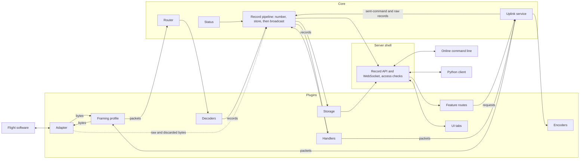
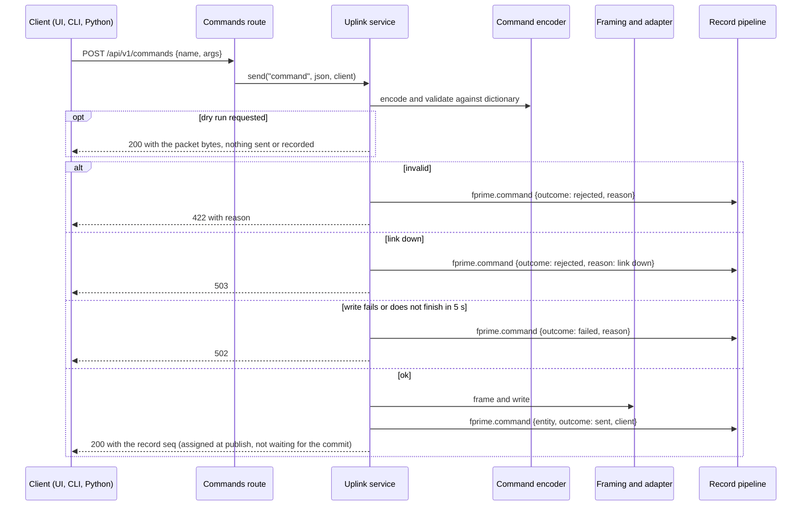

# F Prime GDS in Rust: requirements and architecture

Status: baseline approved by the user on 2026-11-21 (revision 11 of the draft). Implementation follows section 6. Changes to this document go through the orchestrating session. Working names: binary `fgds`, Python package `fgds_client`.

Terms used with one meaning throughout:
- **Extension point**: a Rust trait (or the JavaScript tab contract) that a plugin implements.
- **Plugin**: a crate that registers one or more extension-point implementations under a unique name.
- **Capability**: something a user can do with the GDS (send a command, filter events).
- **Record**: one stored and streamed item (an event, a channel sample, a sent command, a status change).
- **Channel**: one telemetry channel sample. **Telemetry packet**: a packed group of channels.

## 1. Goals

| ID | Goal | From the request |
|---|---|---|
| G1 | Re-implement the F Prime Ground Data System (GDS) from scratch in Rust, in a new repository. | "re-implement from scratch the F' GDS in Rust", "start a new repo" |
| G2 | Feel familiar: similar tabs, similar command-line tools, similar test concepts. Parity of capability, not an identical copy. | "supports all features of the current GDS in a similar fashion" |
| G3 | Plugin-able by default: built-in features use the same public extension points projects use. A goal, not an absolute rule; exceptions are listed in section 4.9. | "everything in our architecture to be plugin-able by default" |
| G4 | Low maintenance for the F Prime team: small core, clear code, projects customize without us. | "maintainability and code clarity is a big focus" |
| G5 | Scriptable from Python, for operations scripts and integration tests. | "should support scripting ... just like the current TestAPI" |
| G6 | Persistent storage in a database. | "could we use databases?" |
| G7 | Browse and view data products in the UI. | "a new Data Products tab" |

## 2. Non-goals

- Compatibility with existing Python GDS plugins.
- XML dictionaries; the old threaded TCP server and ZeroMQ middleware; `fprime-seqgen` as a Python tool (its function moves to SEQ-1).
- A dedicated protocol for running an adapter or framing outside the GDS process. An adapter can run in another process or on another machine by running `fgds comm-bridge` there without framing and pointing the GDS's TCP or UDP adapter at it (CLI-4); framing always runs in the GDS process. The GDS then reports the state of its connection to the bridge, not of the far link.
- Automatic deployment discovery (`fprime-gds -d`): the dictionary and application paths are given by option or configuration file.
- Compiling `FpySequencer` sequences (its own compiler is used; the GDS uplinks the result).
- More than one flight software link per GDS process.
- `pip install` packaging of the Rust binary (revisit later).
- Loading plugins without compiling (no dynamic libraries, no WebAssembly).
- Reading the current GDS dashboard file format.
- Windows without WSL.

## 3. Requirements

Verification: **UT** unit test, **IT** integration test against the `Ref` deployment or a scripted fake flight software, **INS** inspection. "Trace" names the goal served.

### 3.1 Customization

| ID | Requirement | Trace | Verif. |
|---|---|---|---|
| CUS-1 | A project shall be able to add plugins by building its own GDS binary with cargo, from a `main` that lists the default plugins and its own. | G3 | IT (example binary in CI) |
| CUS-2 | The repository shall provide a stock binary containing all default plugins. | G4 | IT |
| CUS-3 | Every capability of sections 3.2 to 3.8 shall be delivered by a plugin through the extension points of section 4.3, except the items listed in section 4.9, each with its reason. | G3 | INS (4.9 list against crate graph) + UT (dependency check MNT-1) |
| CUS-4 | A project shall be able to omit or replace any default plugin from its `main` without editing GDS source; the stock capabilities of the remaining plugins shall still work. | G3 | IT (build without Charts; build with a replaced framer) |
| CUS-5 | A single plugin crate shall be able to deliver backend logic, web routes, a UI tab, command-line arguments and subcommands together. | G3 | IT (example plugin does all five) |
| CUS-6 | A project framer shall be usable on the link, a project adapter shall carry the link, and a project UI tab shall appear in the browser, each selected or enabled without a GDS source change. | G3 | IT (example custom framer, adapter and tab) |
| CUS-7 | A project plugin shall be able to add a new kind of record that is stored, queryable through the API, streamed to clients and readable from Python without changes to the core, the storage plugin or the Python client. | G3, G5 | IT (example record kind) |
| CUS-8 | A project shall be able to register a custom renderer for a channel or a type, and a custom input for a command argument type, inside the built-in tabs. | G3 | IT |
| CUS-9 | At run time an operator shall be able to select among compiled-in adapters, framing profiles and storage plugins, and disable any plugin other than the selected adapter, framing layers and storage, by option or configuration file. | G3 | IT |
| CUS-10 | Startup shall fail with a message naming both plugins when two plugins register the same plugin name, route prefix, tab identifier, subcommand, argument, record kind or decoder match rule, when a required extension point (adapter, framing profile, storage) has no implementation, and when a plugin requires a record kind that no compiled-in plugin provides. | G3, G4 | UT |
| CUS-11 | The public extension points shall be versioned with semantic versioning; a breaking change shall change the major version (minor version before 1.0). | G4 | INS + UT (`cargo semver-checks` in CI) |

### 3.2 Flight link and data handling

| ID | Requirement | Trace | Verif. |
|---|---|---|---|
| LNK-1 | The GDS shall load the F Prime JSON dictionary: commands, events, channels, parameters, types, constants, telemetry packets, data product containers and records. | G2 | UT |
| LNK-2 | The GDS shall exit non-zero with a message naming the file and the first problem when the dictionary is missing, is not valid JSON, has duplicate identifiers, or has a type that contains itself. | G2 | UT |
| LNK-3 | The GDS shall provide adapters for TCP client, TCP server, UDP and UART. | G2 | IT (TCP, UDP), UT with a pseudo-terminal (UART) |
| LNK-4 | The GDS shall provide framing profiles for the F Prime protocol and for CCSDS (Space Packet inside TM/TC Space Data Link frames). | G2 | UT (vectors from flight software), IT |
| LNK-5 | The GDS shall decode events, channels and telemetry packets, and shall record every decoded item. | G2 | UT, IT |
| LNK-19 | Facts a framing layer learns about a packet (with CCSDS framing: application identifier, virtual channel, spacecraft identifier, sequence count) shall be passed to the decoder with the packet and kept on the resulting records. With framing that provides none, the metadata shall be empty. | G2, G3 | UT, IT (`Ref` over CCSDS framing) |
| LNK-21 | A request to check a command without sending it (dry run) shall validate and encode it as LNK-10 does and return the packet bytes; nothing shall be sent and nothing recorded. | G2 | UT, IT |
| LNK-22 | An operator shall be able to disable the link through the API and the UI (the adapter is closed and not retried; sends are rejected as under LNK-11) and enable it again, without restarting the GDS. | G2 | IT |
| LNK-23 | Each sent command shall be one item whose state can be updated after sending (rejected, failed, sent, and later completed or failed on board when a plugin reports it); clients shall see the latest state. | G2 | IT |
| LNK-20 | A project shall be able to register a decoder for a packet type, for a packet metadata value (for example an application identifier), or for both, without a change to the core. | G3 | IT (example decoder registered by application identifier) |
| LNK-6 | When the link is absent at start or is lost, the GDS shall keep running, report the link state (LNK-12) and retry at a configurable interval (default 1 s) without restart. | G2 | IT |
| LNK-7 | Every chunk of bytes received and sent shall be written, with its ground time and direction, to raw log files in the run's log directory. | G2 | IT |
| LNK-18 | The GDS shall write one text log per record type (events, channels, commands) to the run's log directory, which is `<--logs directory, default ./logs>/<start time>`. | G2 | IT |
| LNK-17 | The GDS shall write its own log to a file in the run's log directory, directly and not through the database, so that storage and pipeline faults are logged. | G2, G4 | IT |
| LNK-8 | Bytes that do not deframe, packets of an unknown type or identifier, and packets whose payload does not match the dictionary shall each be recorded with their bytes and a reason, and counted; none shall stop the processing of later data. | G2 | UT, IT |
| LNK-9 | Every length or count read from the link, a file or the dictionary shall be checked against a configured maximum and against the bytes available before memory is allocated or data is read. Defaults: frame 1 MiB, file transfer 1 GiB, data product 256 MiB. A deframer shall hold at most one maximum frame of unmatched bytes and discard the oldest beyond that (recorded under LNK-8). | G4 | UT (fuzzing in CI, MNT-6) |
| LNK-10 | The GDS shall encode and send a command only after checking the opcode and every argument against the dictionary (type, range, enumeration value, string length); a failed check shall be returned to the caller as an error and nothing shall be sent. | G2 | UT, IT |
| LNK-11 | A command or raw-send request made while the link is down shall be rejected with an error and shall never be held for later release. The reply to a send request shall be success only after the bytes were written to the adapter, and shall not wait for storage. | G2 | IT |
| LNK-12 | The GDS shall report through the API and show in the UI at all times: link state, time of last received data, counts of frames decoded and bytes discarded, counts of decode errors and unknown packets, storage state, the state of each plugin. | G2, G4 | IT |
| LNK-13 | The GDS shall be able to start the flight software application as a child process (`--app`), capture its output to the GDS log, report its exit in the status, and terminate it when the GDS stops. The GDS shall also run without one. | G2 | IT |
| LNK-14 | On an interrupt or terminate signal the GDS shall stop the link, write all accepted records to the database and terminate the child application before exiting; after 5 s it shall exit regardless, killing the child application and logging what was not written. | G6 | IT |
| LNK-15 | TCP server and UDP adapters shall accept one peer, record the peer address, refuse or ignore any other host while that peer is connected, and take their listen address from an option. | G2 | IT |

### 3.3 Files, sequences, parameters

| ID | Requirement | Trace | Verif. |
|---|---|---|---|
| FIL-1 | The GDS shall uplink files with a queue that supports pause, resume, remove and cancel, a configurable chunk size and cooldown, and progress reporting. | G2 | IT |
| FIL-4 | The uplink queue shall be paused whenever the link is not connected, including at start; when the link drops, the active uplink shall end as failed. The queue shall stay paused until an operator resumes it with the link connected. | G2 | IT |
| FIL-5 | An uplink that makes no progress for a configurable time (default 20 s) shall end as failed and visible, and the queue shall continue with the next file. | G2 | IT |
| FIL-2 | The GDS shall receive downlinked files, report progress, and end a transfer that receives no data for a configurable time (default 20 s) as failed and visible. | G2 | IT |
| FIL-3 | Every name of a file on the ground machine that is received from the flight software or from an API client shall be reduced to a base name inside the configured storage directory (a destination path on the spacecraft is passed unchanged); a name that would resolve outside it shall be rejected. The same check shall be applied when a file is read or served, including for paths found in database records. | G4 | UT, IT (database with a crafted path) |
| SEQ-1 | The GDS shall validate a text command sequence against the dictionary and build the binary file that `Svc::CmdSequencer` accepts, equal to the output of `fprime-seqgen` for the valid files of the fixture corpus, in-process and without starting another program. | G2 | UT (valid files of the corpus compared with `fprime-seqgen` output; invalid input refused) |
| SEQ-2 | The GDS shall uplink a built sequence file, and any already-built sequence file, through FIL-1. | G2 | IT |
| PRM-1 | The GDS shall decode a parameter database file to JSON and encode JSON to a parameter database file (functions of `fprime-prm-decode` and `fprime-prm-write`). | G2 | UT (round trip, fixtures from flight software) |

### 3.4 Browser UI

| ID | Requirement | Trace | Verif. |
|---|---|---|---|
| UI-1 | The GDS shall serve its user interface to a web browser; the frontend shall be JavaScript shipped inside the binary and shall load nothing from another host. | G2 | IT (browser test with network blocked) |
| UI-2 | The UI shall provide each capability of table 3.4-A. | G2 | IT (one browser test per row) |
| UI-3 | A tab that fails to load or throws shall be replaced by an error panel naming the plugin; the other tabs shall keep working. | G3, G4 | IT |
| UI-4 | All text that originates from the link, a file, the dictionary or the database shall be displayed as text, never interpreted as HTML or script. | G4 | IT (injection strings in events, file names, data products) |
| UI-5 | The UI shall be served with a Content Security Policy that allows scripts, styles and connections from the GDS origin only forbids inline script and `eval`, and forbids showing the page inside a frame of another site. | G4 | IT |
| UI-6 | Files downloaded through the UI shall be sent as attachments with content sniffing disabled. | G4 | IT |

Table 3.4-A, UI capabilities (parity list):

| Tab | Capabilities |
|---|---|
| Commanding | Pick a command by name with search; typed argument inputs with validation errors shown; send; history of sent commands with outcome; resend from history |
| Events | Live table; filter by text, severity, component; pause and resume scrolling; colour by severity; time display in flight time and ground time |
| Channels | Latest value per channel; filter; display of structures and arrays; limits highlighted; telemetry packet view when a packet set is loaded |
| Uplink | Choose files and destination; queue with pause, resume, remove, cancel; progress |
| Downlink | List of transfers with progress and state; download a received file |
| Dictionaries | Browse commands, events, channels, parameters with search; dictionary version shown |
| Charts | Plot one or more numeric channels over time; pause; zoom; several charts |
| Logs | View and follow the GDS log and the per-type text logs |
| Sequences | Edit sequence text; validate with errors shown by line; build; uplink |
| Dashboard | Arrange channel, event, chart and command widgets on a page; save and load a layout (new format: JSON data naming widgets by identifier, never code) |
| Advanced | Settings, GDS status and statistics, loaded plugins and versions |
| Data Products | Section 3.6 |

### 3.5 Command-line tools

| ID | Requirement | Trace | Verif. |
|---|---|---|---|
| CLI-1 | `fgds run` shall start the GDS; every option shall also be settable from a configuration file given by `--config`, or `fgds.toml` in the current directory when present (its path is printed at start), with the command line taking precedence. | G2 | IT |
| CLI-2 | `fgds check` shall load the configuration, dictionary and plugins, print what would be started, and exit without opening the link. | G4 | IT |
| CLI-3 | Against a running GDS, the command line shall: list and follow events and channels with filters by identifier, component and search string and optional JSON output; list commands; send a command; send raw bytes; uplink a file (functions of `fprime-cli`). | G2 | IT |
| CLI-4 | `fgds comm-bridge` shall forward data between two adapters, with or without framing, without the rest of the GDS. A GDS shall work with its adapter connected to such a bridge that holds the flight software link. | G2 | IT (including the GDS behind a bridge) |
| CLI-5 | Without a running GDS, the command line shall: decode and validate a data product file (`fprime-dp decode`, `validate`), decode and write parameter files (PRM-1), build a sequence (SEQ-1), and merge dictionaries (`fprime-merge-dictionary`). | G2 | UT, IT |
| CLI-6 | `fgds --version` shall print the GDS version, the API version and each compiled-in plugin with its version. | G4 | IT |

### 3.6 Data products

| ID | Requirement | Trace | Verif. |
|---|---|---|---|
| DP-1 | The GDS shall index data products from two sources: completed file downlinks, and a watched local directory given by option. | G7 | IT |
| DP-2 | The Data Products tab shall list indexed products with container name, identifier, flight time, priority, size, source and validation result, and filter on each. | G7 | IT |
| DP-3 | Selecting a product shall show its decoded header and records. | G7 | IT |
| DP-4 | The tab shall export a decoded product as JSON equal to the output of the command-line decoder (CLI-5) for the same file. | G7 | IT |
| DP-5 | A product that fails validation (checksum, truncated, unknown container, over the size limit) shall be listed with the error. | G7 | UT, IT |
| DP-6 | A file in the watched directory shall be indexed only when it is a regular file (symbolic links are not followed) and its size has not changed for 2 s; a file that later changes shall be indexed again. | G7 | IT |
| DP-7 | The same product arriving from both sources (equal content hash) shall be listed once, with both sources. | G7 | IT |
| DP-8 | The index shall hold the file name relative to the storage or watched directory and the content hash, not the content; a product whose file is gone, or lies outside the directories configured for this run, shall be listed as missing and shall not be read. | G7 | IT |

### 3.7 Storage

| ID | Requirement | Trace | Verif. |
|---|---|---|---|
| STO-1 | Every record (events, channels, sent commands with their outcome, discarded and undecodable data, file transfers, data product index entries, status changes) shall be stored in a database. | G6 | IT |
| STO-2 | The default storage plugin shall use SQLite compiled into the binary. | G6 | INS |
| STO-3 | With `--database <file>` the GDS shall open that file, creating it if absent, keep its existing records visible, and add new records to it. Without the option it shall create `<log directory>/<start time>/gds.db` and keep it after exit. | G6 | IT |
| STO-4 | Each start shall create a new run in the database holding the start time, the dictionary content and its versions, and the plugin list. Every record shall carry its run and the ground receive time. | G6 | IT |
| STO-5 | A record from an earlier run shall be displayed with the values decoded at the time; a dictionary that differs from an earlier run's shall produce a warning in the log and status, not a refusal. | G6 | IT |
| STO-6 | A release shall open databases of every earlier schema version, migrating a file opened for writing after copying it to `<file>.bak`. Opening a database with a newer schema version shall exit non-zero with a message naming the file, its schema version and the supported versions. | G6 | UT (fixture file per released schema version) |
| STO-16 | The status shall report the database size and free disk space, with a warning below a configurable free-space threshold. | G6 | IT |
| STO-7 | All clients shall see the same history, including records received before they connected. History and current-state requests shall default to the current run and shall accept a run; the UI shall show which run is displayed. State left unfinished by an earlier run (a transfer in progress) shall never be shown as current. | G6 | IT |
| STO-8 | A project shall be able to replace the storage plugin. | G3 | IT (in-memory storage plugin used by tests) |
| STO-9 | A storage commit that fails or does not finish within 2 s shall be reported in the log, the API status and the UI; decoding, live delivery to clients and commanding shall continue. Records accepted meanwhile shall be delivered to clients marked as not stored and shall not be written later. When storage accepts records again, the range lost shall be reported as a gap, with the first and last missing sequence numbers, in the status, in the database, and to any client whose replay crosses the gap. | G6 | IT (fault injection: failing and hanging storage) |
| STO-14 | A sequence number shall never be used for two records, including after a restart that follows a storage failure. | G6 | IT |
| STO-15 | A database file that fails to open or fails its integrity check shall cause a non-zero exit with a message naming the file; the GDS shall not repair or replace it. | G6 | UT |
| STO-10 | A database file already opened for writing by another GDS shall cause a non-zero exit with a message naming the file. | G6 | IT |
| STO-11 | After the GDS process is killed, at most the records accepted in the last 200 ms shall be missing, and the database shall open without repair. | G6 | IT |
| STO-12 | With `--read-only` and `--database`, the GDS shall serve the UI and API from the file without opening a link and without modifying the file; operator routes shall return an error. | G6 | IT (file hash unchanged) |
| STO-13 | A database file shall be opened with SQLite's defensive settings for untrusted files. | G4 | UT |

### 3.8 Network API, scripting and testing

| ID | Requirement | Trace | Verif. |
|---|---|---|---|
| API-1 | The GDS shall expose one network API (HTTP with JSON, and a WebSocket stream) used by the UI, the online command-line tools (CLI-3) and the Python client. | G5 | INS |
| API-2 | The API shall be described by an OpenAPI document kept in the repository and checked against the server in CI. | G4, G5 | UT |
| API-3 | The API shall carry its version in the path and in a version endpoint. | G5 | UT |
| API-4 | 64-bit integers shall be encoded as decimal strings, non-finite floats as the strings `NaN`, `Infinity`, `-Infinity`, bytes as base64, ground time as an ISO 8601 UTC string with microseconds, and flight time as an object with time base, context, seconds and microseconds. | G5 | UT |
| API-5 | Every record shall carry a sequence number that increases in storage order. A client shall be able to read records after a given sequence number and continue with live records with none repeated and none missing, except a gap reported under STO-9. | G5, G6 | IT |
| API-6 | A client that reads the live stream too slowly shall be disconnected with a notice carrying the last sequence number sent; it shall not delay other clients, decoding or storage. | G5 | IT |
| API-7 | A history query shall return at most a configured number of records (default 1,000, maximum 10,000) with a cursor for the next page. A request body over a configured size shall be rejected. | G5 | UT |
| API-8 | A malformed or invalid request shall return an HTTP 4xx status with a JSON body holding an error code and message, and shall have no other effect. | G5 | UT |
| SCR-1 | A Python client package shall provide: send a command; read and await events and channels; read sent-command history; uplink and downlink files; read GDS status; and generic access to any record kind and any route. | G5 | IT |
| SCR-2 | The Python client shall not depend on the Rust build and shall refuse to run against an unsupported API version with a message naming both versions. | G5 | UT |
| SCR-3 | The Python package shall provide a pytest fixture, the predicates of the current Test API, and the operations of table 3.8-A under the same names. | G5 | IT (the `Ref` integration tests pass with edits limited to imports and fixture setup; tests that run `fprime-seqgen` call SEQ-1 instead) |
| SCR-4 | A test shall be able to start from "now": the fixture shall take the current sequence number at start and search only later records; clearing a history shall move that client's starting point and shall delete nothing. | G5 | IT |
| SCR-5 | The Python client shall write a test log file listing each command sent, each assertion with its result, and the records matched. | G5 | IT |
| SCR-6 | Predicates shall be evaluated in the Python process; the server shall accept structured filters only and shall never evaluate client-supplied code. | G4 | INS |

Table 3.8-A, Test API operations kept by name: `send_command`, `send_and_await_event`, `send_and_await_telemetry`, `send_and_assert_command`, `send_and_assert_event`, `send_and_assert_telemetry`, `await_event`, `await_event_sequence`, `await_event_count`, `assert_event`, `assert_event_sequence`, `assert_event_count`, `await_telemetry`, `await_telemetry_sequence`, `await_telemetry_count`, `assert_telemetry`, `assert_telemetry_sequence`, `assert_telemetry_count`, `get_event_pred`, `get_telemetry_pred`, `translate_command_name`, `translate_event_name`, `translate_telemetry_name`, `clear_histories`, `get_command_test_history`, `get_event_test_history`, `get_telemetry_test_history`, `uplink_file`, `uplink_file_and_await_completion`, `uplink_sequence`, `uplink_sequence_and_await_completion`, `dictionaries` (with `dictionary_path`), `start_test_case`, `log`, `get_latest_time`, `test_assert`, `predicate_assert`, `set_tlm_packet_level`. Not kept: the sub-history operations (`get_*_subhistory`, `remove_*_subhistory`), `set_event_log_filter`, `wait_for_dataflow`, `get_deployment`, `get_config_file_path`, `load_config_file`, `get_mnemonic`, `get_prm_db_path`; a filtered `client.records(...)` query replaces the sub-histories.

### 3.9 Security

Trust boundaries: bytes from the link, files (data products, downlinks, sequences, dictionaries), database files and API requests are untrusted. Plugins are compiled in by the project and are trusted code.

| ID | Requirement | Trace | Verif. |
|---|---|---|---|
| SEC-1 | By default the API and UI shall listen on 127.0.0.1 only; another address shall require an explicit option. | G4 | IT |
| SEC-9 | An earlier run's dictionary and records read from a database file shall be treated as untrusted data: parsed with the limits of LNK-2 and LNK-9, displayed under UI-4, and never used as a file path without FIL-3. | G4 | IT |
| SEC-5 | Each sent command, raw send, uplink, sequence and uplink-queue action record shall carry the client that requested it (client name, remote address). | G4 | IT |
| SEC-6 | Configuration values declared secret by a plugin shall not appear in the log, the API, the UI or the database. | G4 | UT |
| SEC-7 | The GDS shall start child processes only from its startup configuration, never from the content of an API request. | G4 | INS |

Deferred, by the user's decision to focus on a local run first (not in any milestone below):
- Access tokens when the GDS listens on a network address.
- Operator and viewer roles.
- A browser sign-in page and session cookie.
- Rejecting requests whose `Host` or `Origin` header does not match the GDS's own address (protection against other web pages open in the operator's browser).

To keep these cheap to add later, every route declares at registration whether it only reads or also changes state, and the shell is the single place every request passes through.

### 3.10 Maintainability

| ID | Requirement | Trace | Verif. |
|---|---|---|---|
| MNT-1 | The core crate shall depend on no plugin crate. A plugin crate shall depend on the core and on no other plugin crate; plugins interact only through records, the uplink service and the API. | G4 | UT (dependency graph check in CI) |
| MNT-2 | Each plugin shall be unit-tested against test doubles provided by the core (fake context, in-memory storage, scripted adapter). | G4 | INS |
| MNT-3 | An end-to-end test against the `Ref` deployment, built in CI, shall run on every change. | G4 | INS (CI configuration) |
| MNT-11 | A comparison test shall run the same `Ref` scenario against this GDS and against the current `fprime-gds`, and shall fail on any difference in the decoded data or in the bytes sent on the link, as defined in section 6.1. Wording, option reading and the order of refusals are not compared. | G2 | IT (CI) |
| MNT-4 | Every crate shall forbid `unsafe` code by attribute, and CI shall run `cargo fmt --check` and `cargo clippy` with warnings denied. | G4 | UT (CI) |
| MNT-5 | Direct dependencies shall be limited to the list of section 5; adding one shall require a change to that list, and CI shall check licences and advisories with `cargo deny`. | G4 | UT (CI) |
| MNT-6 | Framers, decoders, the data product decoder, the dictionary loader and the sequence compiler shall return an error, and never panic, on any input; CI shall fuzz each. | G4 | UT (fuzzing) |
| MNT-7 | A panic in a plugin task shall be caught, recorded and shown in the status (LNK-12); the link, storage and the other plugins shall keep running. | G3, G4 | IT (example plugin that panics) |
| MNT-10 | Every storage plugin shall pass the storage conformance tests provided by the core (ordering, filters, paging, run scoping, replay). | G3, G4 | UT |
| MNT-8 | Each extension point shall have one worked example plugin in `examples/` built in CI, and one how-to page. | G4 | INS |
| MNT-9 | The GDS shall build and pass its tests on Linux and macOS. | G4 | UT (CI matrix) |

## 4. Architecture

### 4.1 Overview

One process, built on an asynchronous runtime. The following are not plugins (section 4.9): the **core** (registry, record pipeline, uplink service, status, configuration), the **dictionary library**, and the **server shell** (web server, access checks, page shell, generic record API). Everything else is a plugin crate, one per feature.



### 4.2 Records and the pipeline

The record is the only data model shared by plugins, storage, the API, the UI and Python.

```rust
pub struct Record {
    pub seq: u64,                 // assigned by the pipeline; total order; the API cursor
    pub run: u32,                 // STO-4
    pub ground_time: Timestamp,   // when the GDS accepted it
    pub kind: KindId,             // e.g. "fprime.event"; registered by a plugin
    pub flight_time: Option<FlightTime>, // display only; never used for ordering
    pub id: Option<u32>,          // event, channel or opcode identifier, when there is one
    pub entity: Option<String>,   // set for records that update one thing (a transfer, a product)
    pub stored: bool,             // false only while storage is failed (STO-9)
    pub raw: Bytes,               // source bytes, kept for re-decoding
    pub meta: PacketMeta,         // facts from the framing layers; empty when there are none (LNK-19)
    pub body: serde_json::Value,  // decoded content, encoded per API-4
}

pub struct KindSpec {
    pub id: KindId,               // "<namespace>.<name>"; built-ins use "fprime", "raw", "gds"
    pub schema: &'static str,     // JSON Schema of the body: the contract with other plugins and clients
    pub transient: bool,          // true: delivered to handlers only, never stored or replayed
    pub description: &'static str,
    pub fields: &'static [FieldSpec], // body fields a client may filter on: name, JSON pointer, type
    pub text_fields: &'static [&'static str], // fields searched by a free-text filter
    pub has_entities: bool,       // records update one entity; "current state" = latest per entity
}
```

The set of kinds is open: a plugin registers a `KindSpec` and publishes records of it. Storage, the record API, the WebSocket and the Python client handle any kind without knowing it (CUS-7). A plugin gets typed access with `record.body_as::<T>()` for its own `serde` type. Kind schemas are served at `GET /api/v1/kinds` and are part of the versioned interface (CUS-11). File data packets are a transient kind: the downlink handler writes them to the file and publishes only progress records, so file content is not copied into the database. Raw link bytes go to raw log files (LNK-7), not to the database. Kinds the core defines: `raw.discarded`, `gds.decode_error`, `gds.unknown_packet`, `gds.status`, `gds.plugin_fault`, `gds.storage_gap`, `gds.storage_recovered`, `gds.app_output`. The GDS log is a file written directly (LNK-17); the Logs tab reads log files through its plugin's routes.

Features that hold state (sent commands, file transfers, the data product index, uplink queue) publish it as records with `entity` set; the latest record per entity within a run is the current state. Nothing is ever deleted or overwritten. No plugin needs its own table. A sent command sets `entity` to a per-send identifier; its `outcome` is `rejected`, `failed` or `sent`, and a handler that matches flight software command-completion events may later publish `completed` or `error` for the same entity (LNK-23). That handler is optional and not part of the first milestones.

Pipeline rule, in order, for every published record:
1. The pipeline assigns `seq` and `ground_time`. Sequence numbers are reserved in the database in blocks ahead of use, so a number is never reused after a restart (STO-14).
2. The record enters a bounded hand-off queue to the storage plugin, which commits in batches (at most 100 ms or 500 records). Records from the uplink service use a reserved part of the queue, so commanding never waits behind telemetry. When the queue is full, reading from a TCP link waits (which pushes back on the sender rather than dropping data), for at most the commit time-out. UDP and UART links are always read; their overflow goes to the memory buffer of the failure path below, so nothing is dropped unseen by the operating system.
3. After its batch is committed, the record is broadcast to subscribers (handlers, WebSocket clients).

So in normal operation a record is never live before it is stored, and `seq` is the same order in storage and on the stream. A subscriber gives a starting `seq`; the pipeline replays from storage, then continues live, with no gap and no repeat (API-5, SCR-4). Each subscriber has its own bounded queue (default 10,000 records). A WebSocket client that overflows is disconnected with its last `seq` (API-6). A handler that overflows is marked lagging in the status and resumes from storage at its last `seq`.

Storage failure (STO-9). A commit that returns an error or does not finish in 2 s puts storage in state `failed`:
- Waiting stops: records are broadcast at once with `stored = false`. They are not held for a later write.
- Every later batch is offered to storage again. When one is accepted, a `gds.storage_gap {first_seq, last_seq}` record (the range that was not stored) and a `gds.storage_recovered` record are written.
- A replay that crosses a gap delivers the gap record in its place, so a client or handler is told what it missed.

### 4.3 Extension points

```rust
pub trait Plugin: Send + Sync + 'static {
    fn manifest(&self) -> Manifest;     // name, version, options (with secret flags), record kinds required
    fn register(&self, reg: &mut Registry) -> Result<()>; // declare implementations; no I/O here
}

// Link
#[async_trait] pub trait Adapter: Send {                  // exactly one active
    // Returns two independent halves: the core reads and writes at the same time, from two tasks.
    async fn connect(&mut self) -> Result<(Box<dyn LinkReader>, Box<dyn LinkWriter>, PeerInfo)>;
    // PeerInfo { address, message_boundaries: bool }: true when each read is one whole message (UDP).
}
#[async_trait] pub trait LinkReader: Send { async fn read(&mut self, buf: &mut BytesMut) -> Result<usize>; } // 0 = closed
#[async_trait] pub trait LinkWriter: Send { async fn write(&mut self, data: &[u8]) -> Result<()>; }

pub trait FramingLayer: Send + Sync {                     // registered by name, e.g. "ccsds-space-packet"
    fn deframer(&self, cfg: &PluginConfig, peer: &PeerInfo) -> Box<dyn Deframe>; // receive direction, own state
    fn framer(&self, cfg: &PluginConfig) -> Box<dyn Frame>;       // send direction, own state
}
pub trait Deframe: Send { fn deframe(&mut self, input: &mut BytesMut, out: &mut Vec<Deframed>) -> Result<()>; }
pub trait Frame: Send   { fn frame(&mut self, packet: &[u8], out: &mut BytesMut) -> Result<()>; }
pub enum Deframed { Packet { bytes: Bytes, meta: PacketMeta }, Discarded { bytes: Bytes, reason: &'static str } }

// Optional facts about a packet, filled in by framing layers and carried to the decoder and the record.
// An open set of named values: the core knows no key. Each layer adds its own and keeps those of the layers before it.
pub struct PacketMeta(BTreeMap<&'static str, MetaValue>);     // MetaValue: U64 | Text
// Keys set by the stock CCSDS layers: "ccsds.apid", "ccsds.vcid", "ccsds.scid", "ccsds.seq_count".

// Data
pub trait Decoder: Send + Sync {
    fn matches(&self) -> PacketMatch;                     // what the router sends to this decoder
    fn decode(&self, packet: &[u8], meta: &PacketMeta, dict: &Dictionary) -> Result<Vec<NewRecord>, DecodeError>;
}
pub struct PacketMatch {                                  // every field given must match
    pub packet_type: Option<PacketType>,                  // the F Prime packet type field
    pub meta: Vec<(&'static str, MetaValue)>,             // e.g. [("ccsds.apid", U64(0x42))]
}
pub trait Encoder: Send + Sync {                          // one per request kind (command, raw)
    fn request_kind(&self) -> &'static str;
    fn encode(&self, request: &serde_json::Value, dict: &Dictionary) -> Result<Encoded, ValidationError>;
}
#[async_trait] pub trait Handler: Send {                  // any number
    fn subscription(&self) -> Filter;                     // which kinds it receives
    async fn run(self: Box<Self>, ctx: Context, records: RecordStream) -> Result<()>;
}
#[async_trait] pub trait Storage: Send + Sync {           // exactly one active
    async fn open(&self, cfg: &StorageConfig) -> Result<RunInfo>;
    async fn append(&self, batch: &[Record]) -> Result<()>;
    async fn query(&self, q: &Query) -> Result<Page>;     // structured filter only, bounded (API-7)
    async fn latest(&self, q: &Query) -> Result<Page>;    // latest record per entity or id, same bounds
    async fn runs(&self) -> Result<Vec<RunInfo>>;
    async fn close(&self) -> Result<()>;
}
pub struct Query { pub kinds: Vec<KindId>, pub run: Option<u32>, pub after_seq: Option<u64>,
                   pub before_seq: Option<u64>, pub ids: Vec<u32>, pub time: Option<TimeRange>,
                   pub filters: Vec<FieldFilter>,   // on fields declared in KindSpec only
                   pub text: Option<String>,        // case-insensitive substring of the kind's text_fields
                   pub limit: u32 }                 // run: None means the current run
pub struct FieldFilter { pub field: String, pub op: Op /* Eq Ne Lt Le Gt Ge Contains */, pub value: serde_json::Value }

// Front ends
pub struct Routes { pub prefix: &'static str, pub router: axum::Router<Context>, pub access: Vec<RouteAccess> }
pub struct UiBundle { pub tab_id: &'static str, pub title: &'static str, pub order: u32,
                      pub module: &'static str, pub files: &'static dyn EmbeddedFiles }
pub trait Subcommand: Send + Sync {                       // offline or online command-line tool
    fn command(&self) -> clap::Command;
    fn run(&self, args: &clap::ArgMatches, env: &CliEnv) -> Result<ExitCode>;
}
pub struct CliEnv<'a> {
    pub config: &'a Config,                 // merged options and configuration file
    pub registry: &'a Registry,             // compiled-in adapters, framing layers (used by comm-bridge)
    pub dictionary: &'a dyn Fn() -> Result<Arc<Dictionary>>,  // loaded on demand by offline tools
    pub client: &'a dyn Fn() -> Result<ApiClient>,            // HTTP and WebSocket client to a running GDS:
}                                                             // address from config or environment
pub struct ChildApp { pub name: String, pub program: PathBuf, pub args: Vec<String> } // supervised process
```

| Extension point | Active at run time | Chosen by | Built-in plugins |
|---|---|---|---|
| Adapter | one | `--comm <name>` | `tcp-client`, `tcp-server`, `udp`, `uart` (one crate each) |
| Framing layer | several, as an ordered profile | `--framing <profile>` or `--framing-layers a,b,c` | layers `fprime`, `ccsds-space-packet`, `ccsds-tm-tc`; profiles `fprime`, `ccsds` |
| Decoder | one per match rule (packet type, metadata value, or both) | registration | events, channels, telemetry packets, file packets |
| Encoder | one per request kind | registration | command, raw |
| Handler | many | registration; `--disable-plugin` | downlink, uplink queue, data product indexer, text loggers |
| Storage | one | `--storage <name>` | `sqlite`; `memory` (tests) |
| Routes | many, unique prefix | registration | one set per feature plugin |
| UI tab, widgets, renderers, argument inputs | many, unique tab id | registration | the 12 tabs |
| Subcommand, arguments | many, unique names | registration | section 3.5 |
| Child application | many | configuration | flight software launcher |

When `message_boundaries` is true the core passes each read to the deframer as one complete unit, and whatever the deframer leaves of that unit is discarded and recorded (LNK-8), so framing recovers at the next message after a bad one. When false the deframer sees a continuous byte stream.

A framing profile is data, not code: a name and an ordered list of layer names (`reg.add_framing_profile("ccsds", &["ccsds-tm-tc", "ccsds-space-packet"])`). A project that adds one layer (a project header, encryption) registers its layer and a profile that names the stock layers beside it, without depending on the stock framing crates and without re-implementing them.

Third-party types in the public interface, re-exported by the core and part of the extension-point version (CUS-11): `axum` (Routes), `clap` (Subcommand), `serde_json` (record bodies, requests), `bytes` (buffers), `async-trait`. No other third-party type appears in a trait.

The core provides a storage conformance test suite (MNT-10) that fixes the meaning of every `Query` field, so a second storage plugin behaves like the first.

What a plugin receives when started:

```rust
pub struct Context {            // cheap to clone
    pub dictionary: Arc<Dictionary>,
    pub records: Records,       // publish(NewRecord), subscribe(Filter, from_seq), query(Query), latest(..)
    pub uplink: Uplink,         // send(request_kind, json, client) and send_packet(bytes, client)
    pub status: StatusHandle,   // set this plugin's state and counters (LNK-12)
    pub config: PluginConfig,   // this plugin's parsed options; secrets are redacted on display
    pub shutdown: ShutdownToken,
}
```

Composition by a project (CUS-1, CUS-4):

```rust
fn main() -> ExitCode {
    fgds::Gds::builder()
        .with_defaults()                       // all default plugins
        .without("charts")                     // omit one
        .replace("framing-fprime", my::Framing)// replace one
        .with(my::ThermalTab)                  // add one
        .override_decoder(my::EventDecoder)    // swap one implementation, keep the stock feature
        .run()
}
```

### 4.4 Lifecycle and fault containment

Start order: configuration and dictionary; `register` for every plugin and conflict check (CUS-10); storage open and new run (STO-4); handlers; server shell with routes and tabs; child applications; framing profile; adapter last. Stop is the reverse, ending with a storage flush (LNK-14). Startup writes the loaded configuration (secrets redacted), dictionary version and plugin list to the log and the run.

| Fault | Behaviour |
|---|---|
| Panic in a handler, route, adapter or child-application task | Each runs in its own supervised task. The panic is caught, published as `gds.plugin_fault`, and shown in the status. Adapters and storage are restarted with back-off; optional plugins stay stopped until restart (MNT-7). |
| Panic or error in a decoder or framing call | Caught around the call; the input becomes a `gds.decode_error` or `raw.discarded` record; a framing layer that panicked is rebuilt before the next input (LNK-8). |
| Plugin code that blocks without yielding | A handler stalls only itself. A decoder or framer stalls the link pipeline; this case is neither detected nor contained for now (a stall watchdog is deferred). This case is detected, not contained. |
| Link disabled by an operator | Adapter closed, state `disabled`, no retry until enabled again (LNK-22); sends are rejected (LNK-11). |
| Link lost or absent | Adapter state `disconnected`, retry every 1 s (LNK-6); in-progress transfers fail by time-out (FIL-2); sends are rejected (LNK-11). |
| Storage write failure, full disk, commit that hangs | Section 4.2, storage failure (STO-9). |
| Slow client or handler | Section 4.2 (API-6). |
| Child application exits | Reported in the status with its exit code; the GDS keeps running (LNK-13). |

Containment needs unwinding: a binary built with `panic = "abort"` logs a warning at start and shows it in the status. In read-only mode (STO-12) the pipeline, link, handlers that write, and run creation are not started; the shell serves queries from the file, opened immutable, and status from memory.

Threads: the asynchronous runtime runs the link pipeline, handlers and the server. SQLite is synchronous, so the storage plugin owns one writer thread and a small pool of reader threads and never runs a query on a runtime thread.

### 4.5 Uplink path

All sending goes through the core uplink service, so every send is validated, recorded and visible to every client. (Project rules checked before a send, such as confirmation of hazardous commands, are deferred; this service is the one place to add them.)



File uplink is a handler that owns the queue (FIL-1) and sends file packets with `uplink.send_packet`; it is not an encoder.

### 4.6 Storage schema (SQLite plugin)

```sql
CREATE TABLE meta    (key TEXT PRIMARY KEY, value TEXT);              -- schema_version, reserved_seq
CREATE TABLE runs    (run INTEGER PRIMARY KEY, started TEXT, gds_version TEXT,
                      dictionary_hash TEXT, dictionary_json BLOB, plugins_json TEXT);
CREATE TABLE records (seq INTEGER PRIMARY KEY, run INTEGER, ground_time INTEGER, kind TEXT,
                      flight_time TEXT, id INTEGER, entity TEXT, raw BLOB, meta TEXT, body TEXT);
CREATE INDEX records_kind_seq   ON records(kind, seq);
CREATE INDEX records_kind_id    ON records(kind, id, seq);
CREATE INDEX records_entity     ON records(kind, entity, seq) WHERE entity IS NOT NULL;
```

Write-ahead logging with a 100 ms batch commit gives STO-11. The file is locked for one writer (STO-10). `seq` continues from `reserved_seq`, which is always ahead of any number handed out, so order holds across runs and no number is reused (STO-14). Declared fields are filtered with SQLite's JSON functions, with an expression index per declared field. The file is integrity-checked at open (STO-15). Old runs are displayed from `body` as decoded at the time (STO-5); the run's own dictionary is kept for re-decoding from `raw`. Queries are built from `Query` fields with bound parameters only.

### 4.7 Network API (version 1)

| Route | Access | Purpose |
|---|---|---|
| `GET /api/v1/version` | read | API and GDS versions, plugins (API-3) |
| `GET /api/v1/status` | read | LNK-12 |
| `GET /api/v1/dictionary` | read | Current dictionary; `?run=` for an earlier run |
| `GET /api/v1/runs` | read | Runs in the database |
| `GET /api/v1/records?kind=&run=&after_seq=&id=&text=&limit=` | read | History page with next cursor (API-7) |
| `GET /api/v1/records/latest?kind=&run=&limit=` plus field filters | read | Current state per entity or identifier, paged, current run by default |
| `GET /api/v1/cursor` | read | Highest `seq` now (SCR-4) |
| `WS /api/v1/stream?kind=&after_seq=` | read | Replay from `after_seq`, then live (API-5) |
| `POST /api/v1/commands`, `POST /api/v1/raw` | write | Section 4.5; `?dry_run=true` on commands validates and encodes only (LNK-21) |
| `POST /api/v1/link {enabled}` | write | Disable or enable the link (LNK-22) |
| `/api/v1/<plugin prefix>/...` | declared per route | Feature plugins: files, sequences, data products, logs, dashboards |
| `GET /ui/tabs` | read | Tab list for the page shell |

Online command-line tools and the Python client use these routes only. A plugin's routes and record kinds are reachable from Python through `client.records(kind=...)`, `client.get(path)` and `client.post(path, json)` (SCR-1), so a project feature is scriptable without a client release.

Every request, including those to plugin routes, passes through the shell before the plugin's code runs; the shell applies the request size limit and records the client (SEC-5). Access control is deferred (section 3.9) and will be added at this one place.

### 4.8 Frontend

Standard Web Components, with the Lit library shipped inside the binary; no build step, no in-browser template compilation, so the Content Security Policy of UI-5 holds. The contract is the custom element and the `gds` object, not Lit: a project tab may be written in plain JavaScript or anything that produces a custom element.

A tab is an ES module, embedded in its plugin crate, whose default export is:

```js
export default {
  id: "thermal", title: "Thermal",
  element: "thermal-tab",            // custom element the module defines; its name starts with the tab id
  setup(gds) { /* optional: register renderers, argument inputs */ },
};
```

The shell passes each tab the same `gds` object (contract version exposed as `gds.version`):

| Member | Purpose |
|---|---|
| `gds.api.get(path)`, `gds.api.post(path, body)` | API calls |
| `gds.records.subscribe({kinds, afterSeq}, callback)` | One shared WebSocket for all tabs; replay then live |
| `gds.records.query({...})`, `gds.records.latest(kind)` | History and current state |
| `gds.dictionary` | Loaded dictionary, cached |
| `gds.status` | Observable GDS status |
| `gds.format.time(...)`, `gds.format.value(type, value)` | Shared formatting |
| `gds.renderers.register(match, fn)` | Custom display for a channel or type inside built-in tabs (CUS-8) |
| `gds.inputs.register(type, element)` | Custom command argument input (CUS-8) |
| `gds.widgets.register({id, title, element})` | Offer a display element to other tabs. The Dashboard lists whatever widgets are registered and imports no other tab; a layout naming a widget whose plugin is absent shows a placeholder |
| `<gds-table>`, `<gds-filter>`, `<gds-value>` | Shared components for a common look |

The shell imports each tab module inside a guard: a module that fails to load or an element that throws is replaced by an error panel (UI-3). Values are placed in the page as text; the HTML-injection helpers of Lit are forbidden by a lint rule in CI (UI-4). A status bar from `gds.status` is always visible (LNK-12).

### 4.9 What is not a plugin, and why

| Item | Reason |
|---|---|
| Core: registry, record pipeline, router, uplink service, status, configuration, supervisor | They are what plugins plug into; ordering, storage-before-broadcast and fault containment must hold for every plugin. |
| Dictionary library | Every decoder, encoder and tool needs the same typed model; it appears in trait signatures. A project needing a different dictionary source converts to this model. |
| Server shell: web server, access checks, generic record API, WebSocket, page shell, status bar | Access checks must wrap every route; one shared stream and one page host are needed before any tab exists. |
| Router | A lookup table in the core, built at start from the decoders' match rules. For each packet it picks the decoder whose rule matches, preferring a rule with metadata conditions over one with a packet type alone; two rules that can match the same packet with equal precedence fail startup (CUS-10). A packet that matches no rule is recorded as unknown (LNK-8). It stays in the core so that ordering, error containment and the accounting of unknown packets hold for every project; projects change what is routed where by registering decoders, not by replacing the router. |

### 4.10 Workspace layout

```
crates/
  fgds-dictionary        dictionary model, F Prime type encode/decode            (library)
  fgds-core              section 4.2-4.5 core, extension-point traits, test doubles
  fgds-shell             web server, access checks, record API, page shell
  fgds                   Gds::builder, stock binary `fgds`
plugins/                 each depends on fgds-core (and fgds-dictionary) only
  comm-tcp  comm-udp  comm-uart
  framing-fprime  framing-ccsds
  storage-sqlite  storage-memory
  events  channels  commands        decoder or encoder + routes + tab + online subcommand
                                    (channels also decodes telemetry packets; commands also holds the raw encoder)
  files                             uplink queue, downlink, Uplink and Downlink tabs, file-uplink subcommand
  data-products                     decoder library, indexer, tab, `dp` subcommands
  sequences                         CmdSequencer compiler, tab, `seq` subcommand
  parameters  dictionary-tools      offline subcommands
  dictionary-view  charts  logs  dashboard  advanced      (logs also holds the text loggers)
  app-launcher  comm-bridge
python/fgds_client       Python client, predicates, pytest fixture
examples/                one worked plugin per extension point; `custom-gds` binary used by CI
```

Each feature is one crate holding its backend, routes, tab and subcommands, so omitting the crate removes the whole feature (CUS-4, CUS-5).

### 4.11 Amendments after the first slice

Accepted from `deviations.md` after the first slice was built, and revised after the review of that slice. Where this section and 4.2 to 4.7 differ, this section wins.

1. `Encoder` has `record_kind()`, and `encode` returns `Encoded { packet, id, body, meta }`: the packet to send, the identifier and the body of the record published for the send, and the metadata given to the framing layers with the packet.
2. A raw send (`Uplink::send_packet(packet, meta, client, keep_raw)`, `POST /api/v1/raw`) is recorded with kind `raw.sent`, whatever its outcome; body: `length`, `client`, `outcome` (`sent`, `rejected` when the link is down, `failed`) and `reason` when not sent. `raw` holds the packet only with `keep_raw`: the API route keeps it, file uplink does not and publishes its own progress records.
3. Adapters, decoders, handlers and encoders are registered as factories of one shape, `Fn(&PluginConfig) -> Result<Box<dyn X>>`, so each can read its options (a decoder bound to an application identifier, for example). Every `add_*` returns `Result`, and a conflict names both plugins. Decoders and encoders are built in `Core::start` and in `fgds check` (`Registry::build_decoders`, `Registry::build_encoders`): the match rule of a decoder is known only then, so the ambiguity check and `override_decoder` run there, on the built decoders, still naming both plugins. An encoder is registered with its request kind (`add_encoder(request_kind, factory)`), which is claimed at registration.
4. `Manifest { name, version, options: Vec<OptionSpec { name, help, default, secret }>, requires_kinds }`. Option `name` of plugin `p` is `--p-name` on the command line, `[plugins.p] name` in the configuration file, and `name` in `PluginConfig`; two plugins may use the same option name. The core builds each `PluginConfig` (`Config::plugin_config`): a key the manifest does not declare is an error, and `OptionSpec.default` is filled in, so a plugin repeats no default. The core's own options (`config`, `dictionary`, `comm`, `framing`, `storage`, `database`, `logs`, `read-only`, `bind`) and subcommands (`run`, `check`) are claimed for `core`; the core options are global arguments, accepted with every subcommand.
5. `RunInfo` has `first_seq`, `reserved_seq` and `dictionary_hash`. `KindSpec.text_fields` are JSON pointers into the body.
6. Record API filters: `filter=<field>:<op>:<value>` with `eq ne lt le gt ge contains in prefix` (`in` takes a comma-separated list), plus `before_seq`, `from`, `to`. Stream messages: `{"type":"record","record":{..}}`, `{"type":"live","seq":".."}` once when the stored records have all been sent (`seq` is the last one sent; at once for a stream without `after_seq`), and `{"type":"lagged","last_seq":".."}` before a slow client is closed.
7. Display text is produced by the decoder, stored in the body as `display_text`, including format strings of array elements and struct members. Format strings are filled by the FPP rules (C `printf` conversions): sign and magnitude for `x` and `o`, `g` as in C, `nan` and `inf` for non-finite values.
8. A decoder may return several records for one packet. The decoder always sets `raw` of each record to that item's own bytes, in one layout per kind, stated in the kind's description (`fprime.channel`: identifier, time tag, value, also for a channel of a telemetry packet; `fprime.event`: identifier, time tag, arguments). The router does not fill `raw`.
9. Every route of a plugin shares one `Context` (`axum::Router<Context>`).
10. The storage failure path is in the pipeline (`pipeline.rs`), so every storage gets it: a commit that fails or exceeds the time-out (2 s) puts storage in state `failed`; records are then broadcast with `stored = false` and are not kept for a later write; every later batch is offered to storage again, and when one is accepted a `gds.storage_gap` record (`first_seq`, `last_seq` of what was not stored) and a `gds.storage_recovered` record are published. There is no buffer of unstored records and no rewrite. `stored` is true for a transient record: false means lost, nothing else. Records of the uplink service have their own queue, taken first by the commit task, and `Records::publish_uplink` never waits (LNK-11).
11. `PacketMeta` and `PacketMatch.meta` keys are `String`, so a storage can rebuild a record it reads back.
12. `Storage::open` gets in `StorageConfig` the dictionary content and hash of the run, the database path, the log directory of the run and `read_only`; with `read_only` it starts no run and returns the last one (STO-12). `Storage::dictionary(run)` returns the dictionary of a run (STO-4), `Storage::reserve(through)` records the sequence number reservation (STO-14). An offline subcommand opens the database with `CliEnv::storage`.
13. `Frame::frame(packet, meta, out)` receives the metadata of the packet. `Deframed::Discarded.reason` is a `String` and carries the error of a failed layer. A layer that demultiplexes (virtual channels) owns the reassembly and emits whole inner packets, each with the metadata of its own channel.
14. `UiBundle.title` is optional: a bundle without a title has no tab, and its module is loaded for `setup` only.
15. Command argument encoding is in `fgds-dictionary`: `Dictionary::encode_command(name, args)` returns the opcode, the bytes (opcode then arguments) and the arguments as sent. The command encoder and the sequence compiler call it.
16. `scripts/check.sh` runs every `tests/*/run.sh`; a part of the GDS adds its checks as such a file.

## 5. Dependencies

| Need | Crate |
|---|---|
| Asynchronous runtime | tokio |
| Web server and WebSocket | axum |
| Database | rusqlite (SQLite bundled) |
| Command line | clap |
| JSON and serialization | serde, serde_json |
| Byte buffers | bytes |
| Async traits | async-trait |
| HTTP and WebSocket client (online command line) | reqwest, tokio-tungstenite |
| Serial port | tokio-serial (only in `comm-uart`) |
| Embedded static files | rust-embed |
| Logging | tracing |
| Errors | thiserror |
| Checksums and hashes | crc, sha2 |
| Directory watching | notify |
| Time | time |
| Base64, configuration file | base64, toml |
| Frontend (vendored file, not a crate) | Lit |
| Python client | requests, websockets, pytest |
| Development only | cargo-deny, cargo-fuzz, cargo-semver-checks, Playwright for browser tests |

## 6. Implementation plan and milestones

### 6.1 Ground truth: the current fprime-gds on `Ref`

The final test of this GDS is to run the `Ref` deployment and see the data we expect. The current `fprime-gds` is the reference for decoded data and for bytes on the link only (MNT-11); messages, command-line reading, page texts and the handling of invalid input are this GDS's own.

- One scripted scenario drives `Ref`: start-up, `CMD_NO_OP` and commands with every argument type, a parameter set and save, a file uplink and downlink, a data product, a sequence run.
- The scenario runs twice in CI, with the same `Ref` binary and dictionary: once against `fprime-gds` (through its Test API), once against this GDS (through the Python client).
- Each run exports what the GDS reported, in one common form: events (identifier, name, severity, arguments, formatted text, flight time), channel samples (identifier, name, value, flight time), commands sent (opcode, arguments, bytes on the link), files received and sent (name, size, hash), decoded data products (the JSON of `fprime-dp`).
- The two exports are compared. A difference fails the test, except for a short written list of accepted differences (ground receive time, ordering between independent sources, samples that depend on timing such as counters and system resources, which are compared by presence and type only).
- For exact, timing-free checks, a capture of the bytes `Ref` sent is replayed into both decoders, and the outputs must be identical.
- Each milestone extends the scenario and the comparison to the data kinds it delivers. The scenario exists from M1.

A second source of ground truth is the test data in the `fprime-gds` repository (`test/fprime_gds/`). These fixtures are copied into this repository with their origin commit, and each parser is tested against them without a running flight software:

| Fixture set in `fprime-gds` | Used for |
|---|---|
| `common/dp/test_dp_data`: 18 data product files (one per record type, compressed and uncompressed `Ref` products, two checksum-failure cases) with their two dictionaries | Data product decoder and validator (DP-3, DP-5, CLI-5): same decoded data as `fprime-dp`, a failure on every invalid file |
| `common/tools/input` and `expected`: 39 sequence files with 37 expected binaries or error texts, with their dictionaries | Sequence compiler (SEQ-1): equal binaries for the valid files, an error on every invalid input |
| `common/loaders/resources/RefTopologyDictionary.json` | Dictionary loader (LNK-1) |
| Byte vectors written in the Python tests for CCSDS framing, encoders, type serialization and parameter files | Framing layers, encoders, type encode/decode, parameter tools (LNK-4, LNK-10, PRM-1): the vectors are ported as Rust unit tests |

Where a fixture has no stored expected output (the data product files), the expected output is generated once by running the current `fprime-gds` tool on it and committed beside the fixture.

### 6.2 How the work is done

1. Freeze this document and commit it to the repository; it is the reference for every session.
2. One session builds a thin end-to-end slice (M0 plus the smallest part of M1) so the core interfaces are proven against `Ref` and the comparison of 6.1 before anything depends on them.
3. Then one sub-session per plugin crate, in parallel, each delivering a small pull request with its tests. The orchestrating session reviews each against this document and owns every change to the core interfaces.
4. Each milestone is gated on its exit tests and the comparison of 6.1 in CI, and gets a local adversarial review before the user is asked to review.

### 6.3 Milestones

Each milestone ends with its exit tests and the comparison of 6.1 (for the data kinds delivered so far) running in CI. Extension points are provisional until M6 and may change between milestones; CUS-11 applies from M6.

| # | Deliverable | Requirements | Exit tests |
|---|---|---|---|
| M0 | Core, shell with the page shell that loads tabs, dictionary, `storage-memory`, storage conformance tests, test doubles, CI with `Ref` built and a browser test harness, `examples/custom-gds` | CUS-1..5, CUS-7, CUS-10, MNT-1..5, MNT-7, MNT-9, MNT-10, UI-3, LNK-1, LNK-2 | Example binary adds a framer, a record kind with route, tab and subcommand; the example tab appears in a browser test; a build without one default plugin works; a panicking example plugin is contained; duplicate registration fails startup |
| M1 | `comm-tcp`, `framing-fprime`, events, channels, commands, `storage-sqlite`, record API | LNK-3 (TCP), LNK-5..12, LNK-14, LNK-17, LNK-18, LNK-21..23, MNT-11, STO-1..7, STO-9..11, STO-14, STO-15, API-1..8, SEC-1, SEC-5 | Against `Ref`: send `CMD_NO_OP` through the API and read its event with replay-then-live; kill and reopen the database; link drop and reconnect; a build with a replaced framing layer; failing and hanging storage with recovery and a reported gap; invalid command rejected; first comparison with `fprime-gds` (events, channels, commands) |
| M2 | Page shell and tabs: Commanding, Events, Channels, Dictionaries, Logs, Advanced; status bar | UI-1..6, table 3.4-A rows for these tabs, CUS-8, CUS-9 | Browser tests per table row; injection strings shown as text; broken example tab shows an error panel |
| M3 | Files plugin, Uplink and Downlink tabs, Python client and pytest fixture, online subcommands | FIL-1..5, SCR-1..6, CLI-1..3, CLI-6, SEC-6, SEC-7, LNK-13 | The `Ref` integration tests that use neither data products (M4) nor sequence building (M6) pass with edits limited to imports and fixture setup |
| M4 | Data products, parameters, dictionary tools, `--read-only` | DP-1..8, PRM-1, CLI-5 (except sequence build), STO-12, STO-13, SEC-9 | Downlink and browse a `Ref` data product; the `Ref` data product integration test passes; decoder output equals `fprime-dp` output on fixtures |
| M5 | `framing-ccsds`, `comm-udp`, `comm-uart`, telemetry packets, `comm-bridge` | LNK-3, LNK-4, LNK-15, LNK-19, LNK-20, CLI-4, MNT-6 | `Ref` over CCSDS framing with packet metadata on the records; an example decoder registered by application identifier; UDP and pseudo-terminal UART tests; fuzzing jobs |
| M6 | Sequences, Charts, Dashboard; how-to pages; extension points declared stable | SEQ-1, SEQ-2, CLI-5 (sequence build), remaining table 3.4-A rows, STO-8, CUS-6, CUS-11, MNT-8 | Valid files of the sequence corpus equal to `fprime-seqgen` output; the `Ref` sequence tests pass; every table 3.4-A row has a passing browser test; every extension point has an example built in CI |

## 7. Decisions

Taken by the author under the user's delegation and confirmed by the user on 2026-11-21; each is reflected above.

1. Sequences: `CmdSequencer` compiler in Rust; `FpySequencer` files are uplinked only.
2. Access: the GDS listens on the local machine by default. Tokens, roles, sign-in and the host and origin check are deferred (user's decision: local run first).
3. Reopened database: one run per start with its own dictionary; a different dictionary is a warning.
4. A command sent while the link is down is rejected, never queued.
5. One process. A remote adapter is `comm-bridge` on the far machine plus a network adapter in the GDS; there is no dedicated remote-plugin protocol (confirmed by the user).
6. API versioned from M1; extension points and API declared stable at M6.
7. Kept: configuration file, uplink queue controls, test log, in-tab renderers. Dropped: deployment discovery.
8. One link per GDS; new dashboard format; Web Components with Lit instead of Vue (strict Content Security Policy without a build step).
9. TCP server and UDP adapters keep an explicit listen address option, defaulting to all interfaces as today, for boards on a bench network.
10. Names: repository `fprime-gds-rs`, binary `fgds`, Python package `fgds_client`.
11. Numbers chosen by the author: LNK-9 limits, STO-9 time-out, STO-11 loss bound, API-7 page sizes.
12. Any program on the local machine can use the GDS, including sending commands, as today.
13. When the link drops, the uplink queue pauses and waits for an operator to resume it.
14. Extras beyond the request. Kept: containment of a crashing plugin, the OpenAPI description checked in CI, fuzzing of parsers. Deferred: the stall watchdog, the load test, project rules checked before a send (uplink guards), and all access control (decision 2).
15. Adopted from the comparison with YAMCS, confirmed by the user: command dry run, the remote adapter recipe, the whole-message hint for framers, operator link disable and enable, one updatable item per sent command, packet metadata with decoder registration by metadata value. The comparison report lists the YAMCS ideas not adopted and why.
16. Storage failure (STO-9), taken by the orchestrator while the user was away, to be confirmed: records accepted while storage is failed are delivered live with `stored = false` and are lost from the database; the lost range is reported as a gap on recovery. The buffer of 100,000 records written on recovery was dropped as not worth its complexity.
